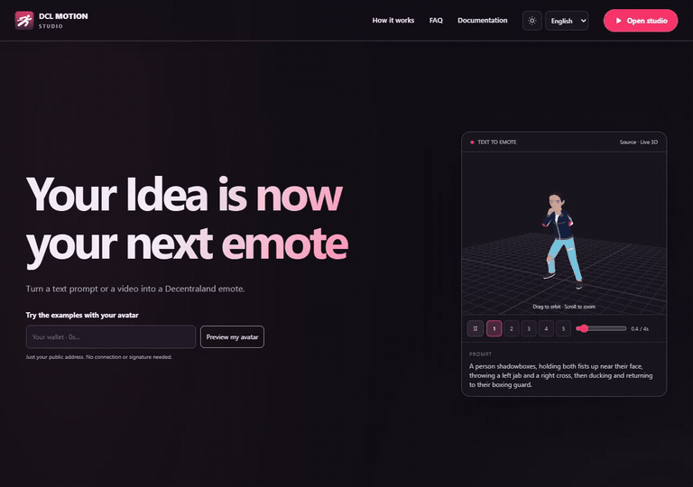
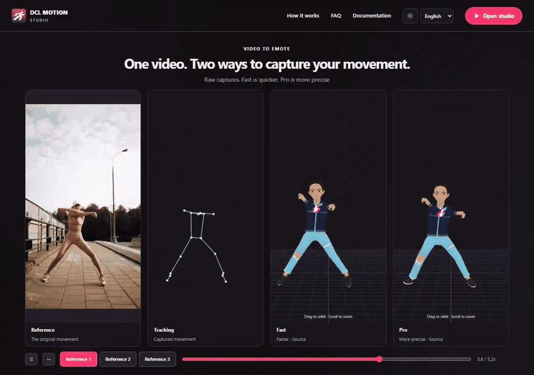

# DCL Motion Studio

Create an avatar animation from a text description or reference video, adjust the movement, and export a GLB animation file. This repository is the version that runs on your own computer and currently targets Decentraland's avatar skeleton.

**Status: experimental beta — local distribution only.** This repository contains the local editor, inference API and base avatar. It is not a standalone installer. Model weights and inference executables are installed separately. The hosted beta, landing page, Docker worker and provider infrastructure are a separate project and are not included.

**Try it before installing:** [live demo](https://dclmotionstudio.xyz/app) · [online documentation](https://dclmotionstudio.xyz/docs) · [project website and examples](https://dclmotionstudio.xyz/).

The live demo is a separate hosted beta for testing without a local setup. Its availability depends on the beta campaign and available processing budget. It processes jobs on remote servers and has its own access/consent notice. The installation below runs the editor and inference on your computer; it does not deploy or connect to that demo.

## Examples

Recordings of the existing landing-page examples. Click a preview to open its MP4 recording.

**Text to emote — prompt and animated avatar**

[](docs/media/text-to-emote.mp4)

**Video to emote — reference, tracking, Fast and Pro**

[](docs/media/video-comparison-1.mp4)

[Watch comparison 2](docs/media/video-comparison-2.mp4) · [Watch comparison 3](docs/media/video-comparison-3.mp4)

These recordings show the published example results; they are not benchmarks or a guarantee for other inputs. [Recording details](docs/media/README.md).

## Before you install

This source distribution requires Node.js 24, model weights and a compiled Kimodo engine. Install the build tools listed below, compile the engine with the supplied patch, then configure its executable and model paths in Studio. The [native build guide](native/kimodo/README.md) describes the engine protocol and troubleshooting.

**The base avatar is already included** at `public/assets/Avatar.glb`. You do not need to obtain another avatar or connect a wallet. A wallet avatar is an optional preview appearance only; exports always use our base avatar or its animated rig without meshes.

If you want to test the tool without local setup, use the [hosted demo](https://dclmotionstudio.xyz/app). If you already have a working installation, go straight to [your first animation](docs/GETTING_STARTED.md). You do not need to read the internal pipeline documents to use the editor.

## What it does

- **Text to motion:** Kimodo through kimodo.cpp, with optional image pose references and native pose constraints.
- **Video to motion:** review and correct tracking observations before conditioned motion generation.
- **Fast capture:** browser MediaPipe plus local RTMW3D ONNX; this path supports CPU execution.
- **Pro capture:** local SAM 3D Body and MoGe, installed separately with their own access requirements.
- **Editing:** hand/foot IK targets, pelvis adjustments, clip trimming, speed, layers and transitions.
- **Export:** bake the selected motion to GLB, with the avatar or as an animated skeleton.
- **Local projects:** the browser and local API store project state without a hosted account.

There is no individual animation keyframe editor. The application currently targets the DCL skeleton; arbitrary rigs and direct Godot, Unity, Unreal or Roblox integration are not validated features. Other characters require an external retargeting workflow, for example in Blender.

## Requirements

- Node.js **24.x** and npm.
- A modern browser with WebGL.
- FFmpeg and FFprobe available on PATH for video preparation.
- A compiled Kimodo executable and downloaded model files for generation.
- The included **DCL base avatar** at `public/assets/Avatar.glb`; keep it in its supplied location.

Text generation and Fast capture can run on CPU. Pro capture requires the separate Python/PyTorch installation and a compatible NVIDIA GPU. There is no universal 4 GB VRAM guarantee: requirements depend on the selected pipeline, model and input. Windows has the most explicit setup scripts in this snapshot; Linux/macOS installation is not certified by this release preparation.

## Local installation

Follow these steps in order. **Installing npm packages alone does not enable generation:** keep the included base avatar, download the model files and install the native Kimodo engine. Start with CPU text generation and Fast capture; add Pro only after the basic setup works.

### 1. Open the project and check Node.js

These detailed commands target **Windows x64 with PowerShell**. Keep the project in a normal writable folder, for example `C:\Projects\dcl-motion-studio`; do not install under Program Files or run commands inside the ZIP. The sample paths below are examples, not folders that already exist on your machine.

If you do not have the tools yet:

| Tool | Install / select | Used for |
| --- | --- | --- |
| Node.js and npm | [Official Node.js downloads](https://nodejs.org/en/download): select **24.x**, even if the page defaults to another major version. Use the Windows x64 installer and include npm/PATH. | Running the editor, API and setup scripts. |
| Git | [Git for Windows](https://gitforwindows.org/): make Git available from the command line. | Cloning Studio and the native engine/submodules. Required for the native build even if you download Studio as a ZIP. |
| CMake | [Official CMake downloads](https://cmake.org/download/): stable Windows x64 installer, version **3.25 or newer**, with its PATH option enabled. | Configuring the native engine. |
| Ninja | [Official Ninja releases](https://github.com/ninja-build/ninja/releases): Windows x64 `ninja-win.zip`, extracted to a folder such as `C:\Tools\ninja`. | Building the native engine. |
| LLVM-MinGW | [LLVM-MinGW 20260908](https://github.com/mstorsjo/llvm-mingw/releases/tag/20260908): Windows **UCRT x86_64** ZIP, extracted to a folder such as `C:\Tools\llvm-mingw-20260908-ucrt-x86_64`. Choose the binary archive, not Source code. | C/C++ compiler and matching runtime DLLs. |

The LLVM-MinGW route matches the toolchain family used for this project's Windows engine. It does not mean that a complete clean engine build has been validated for every machine. Do not combine its DLLs with a binary built using another compiler. The CPU build below does not require a CUDA toolkit, Vulkan SDK or Pro's Python environment.

After installing Node.js, Git and CMake, **close and reopen the terminal** so it sees their PATH entries. If you already have these tools, check their versions rather than reinstalling them. Downloading an archive alone does not put its programs on PATH.

Clone the repository:

```sh
git clone https://github.com/TonyDark0/dcl-motion-studio.git
cd dcl-motion-studio
```

Alternatively, download **Code → Download ZIP** from GitHub and extract it. On Windows, open the extracted project folder in File Explorer and choose **Open in Terminal**. You must be in the folder containing `package.json`, not its parent and not the ZIP itself. Run these commands one at a time:

```sh
node --version
npm --version
```

Use Node.js **24.x**. If `node` or `npm` is not recognized, install Node.js and reopen the terminal before continuing. Windows users can use PowerShell for the steps below.

**Expected:** `node --version` starts with `v24.` and `npm --version` prints a version number. Check the folder contents with `dir`; it should list `package.json`, `src` and `server`. If npm later reports that it cannot find `package.json`, return to this folder.

### 2. Install application dependencies

```sh
npm ci
```

This installs the exact npm dependencies in `package-lock.json`. Keep Internet available; some packages also install native runtime components. Wait for it to finish successfully before running the next command. It does not install the AI weights or compile the native engine.

**Expected:** npm finishes without an installation error and creates `node_modules/`. The presence of that folder alone does not prove installation completed. If it failed, resolve the reported error before continuing.

### 3. Install video tools and download the models

First run:

```sh
npm run setup:video
```

If it installs FFmpeg or tells you to restart, close the terminal, open a new one in the same project folder, then run:

```sh
ffmpeg -version
ffprobe -version
```

Both commands must print version information when installed on PATH. For an existing installation outside PATH, copy the optional configuration template:

```powershell
Copy-Item .env.example .env
```

Run this copy only when `.env` does not already exist. Open `.env` in a text editor, uncomment `FFMPEG_PATH` and `FFPROBE_PATH`, and replace the examples with the full paths to your executables. Both the API and setup scripts load this file. Variables already set in the terminal take precedence. Then rerun `npm run setup:video`; it should report that the tools are ready.

Download the tracking and generation models:

```sh
npm run setup:public
npm run setup:models
```

`setup:video` checks FFmpeg/FFprobe and can install them through Winget on Windows. On other systems, install both tools with your system's package manager. Both version commands must work; restart your terminal if the installer updated PATH.

`setup:public` downloads the MediaPipe pose model. `setup:models` downloads roughly **6.6 GB** of Kimodo, text-encoder, tokenizer and RTMW3D files using pinned revisions and SHA-256 hashes. Allow additional disk space for npm packages and temporary downloads. Internet is required for installation. Review [model licenses](docs/LICENSING.md) before downloading or using the weights.

After successful setup, these files should exist:

```text
public/models/pose_landmarker_full.task
data/models/kimodo/kimodo-soma-rp-v1.1-f32.gguf
data/models/kimodo/Llama-3-Kimodo-Q4_K_M.gguf
data/models/kimodo/tokenizer.gguf
data/models/vision/rtmw3d.onnx
```

The setup scripts verify downloads and reuse completed matching files. They do not currently display a percentage or resume a partly downloaded model: retrying restarts that incomplete file. In particular, the text encoder is about 5 GB, so a download can take a long time. If a download fails, resolve the reported connection, disk-space or hash error, then rerun that setup command. Do not rename a different checkpoint to match an expected filename.

See [Models and runtimes](docs/MODELS_AND_RUNTIMES.md) for what each file does, CPU/GPU requirements, optional Pro dependencies and what is not included in the source package.

**Expected:** both setup commands finish with a verified/installed message. Pro model downloads are not needed for this first setup.

### 4. Check the included base avatar

The repository and source ZIP already contain **`public/assets/Avatar.glb`**. There is nothing to download or configure for this step. Keep its name and location unchanged; the editor uses this skeleton for animation processing and export.

**Expected:** that file exists after cloning or extracting. If it is missing, restore it from this repository/source ZIP rather than substituting an arbitrary character.

You can optionally [load a wallet avatar](docs/custom-avatar.md) for visualization. **Export GLB** still includes our base avatar; **Export emote** contains its animated rig without meshes. Wallet wearables are never exported.

### 5. Build and configure the native Kimodo engine

The engine is a separate program. `npm ci` and the model download commands do not compile it. Use the Windows x64 toolchain from step 1; the [native guide](native/kimodo/README.md) also explains the protocol and build troubleshooting.

**A. Make your extracted compiler and Ninja available in this terminal.** Run from the Studio folder containing `package.json`. Replace the two example paths with your actual extracted folders:

```powershell
$compilerRoot = 'C:\Tools\llvm-mingw-20260908-ucrt-x86_64'
$ninjaRoot = 'C:\Tools\ninja'
$env:Path = "$compilerRoot\bin;$ninjaRoot;$env:Path"
git --version
cmake --version
ninja --version
clang --version
clang++ --version
```

Every version command must work. Check that `Get-Command clang++` points inside your selected LLVM-MinGW folder. These PATH changes apply only to this terminal and its child processes; repeat them if you open another terminal for a build. If a program is not found, correct its path before continuing.

**B. Download the pinned engine source and apply Studio's patch.** Run the following lines one at a time. Stop if any command fails. These commands are for a new engine checkout; if `data/build/kimodo.cpp` already exists, inspect it before retrying. Do not apply the patch twice.

```powershell
$studioRoot = (Get-Location).Path
$engineRoot = Join-Path $studioRoot 'data/build/kimodo.cpp'
$buildRoot = Join-Path $engineRoot 'build/studio'
$installRoot = Join-Path $studioRoot 'data/bin/kimodo-constraints'
New-Item -ItemType Directory -Force (Split-Path $engineRoot) | Out-Null
git clone https://github.com/localai-org/kimodo.cpp $engineRoot
git -C $engineRoot checkout 5679ff19ba0a522c0b0516e9a9d402fe1af2c027
git -C $engineRoot submodule update --init --recursive
git -C $engineRoot apply --check (Join-Path $studioRoot 'native/kimodo/constraints.patch')
git -C $engineRoot apply (Join-Path $studioRoot 'native/kimodo/constraints.patch')
```

The submodule step downloads GGML, which the generator requires. A failed patch check is a reason to stop and inspect the source revision or existing patch state.

**C. Configure and compile the CPU engine.** Keep the same terminal open so the variables above remain defined:

```powershell
cmake -S $engineRoot -B $buildRoot -G Ninja -DCMAKE_BUILD_TYPE=Release "-DCMAKE_C_COMPILER=$compilerRoot/bin/clang.exe" "-DCMAKE_CXX_COMPILER=$compilerRoot/bin/clang++.exe" -DKIMODO_BUILD_TESTS=OFF -DKIMODO_ENABLE_VULKAN=OFF -DGGML_VULKAN=OFF -DGGML_OPENMP=OFF
cmake --build $buildRoot --target kmd-generate --parallel 2
```

Expected: CMake configuration succeeds, followed by a successful build containing `kmd-generate.exe`. Compilation can take time. If you change compilers later, use a separate build directory instead of reusing a CMake cache made by a different compiler.

**D. Install the executable, build libraries and compiler runtime together.** These commands copy into the project's ignored `data/` folder:

```powershell
New-Item -ItemType Directory -Force $installRoot | Out-Null
Copy-Item (Join-Path $buildRoot 'kmd-generate.exe') $installRoot -Force
Get-ChildItem $buildRoot -Recurse -Filter '*.dll' | ForEach-Object { Copy-Item $_.FullName $installRoot -Force }
Get-ChildItem (Join-Path $compilerRoot 'bin') -Filter '*.dll' | ForEach-Object { Copy-Item $_.FullName $installRoot -Force }
& (Join-Path $installRoot 'kmd-generate.exe') --capabilities
```

The final command must exit successfully and report `constraints: soma30-v1` and `protocol: C1`. Typical LLVM-MinGW runtime libraries include `libc++.dll`, `libunwind.dll` and `libwinpthread-1.dll`; the copy step uses the DLLs supplied by your selected toolchain rather than asking you to obtain individual files elsewhere. Build-produced GGML libraries must also remain beside the executable.

The expected executable is now `data/bin/kimodo-constraints/kmd-generate.exe`. An unpatched upstream executable does not provide Studio's conditioned generation and native loop workflow. A successful capability check verifies that the program can start and supports the protocol; it **does not load or test the AI weights**.

Linux/macOS require shell-appropriate toolchains, executable/library names and paths. These Windows copy commands do not apply to them; this release does not provide a verified installation walkthrough for those systems.

### 6. Start the local editor

```sh
npm run dev
```

Keep this terminal open. Visit **[http://127.0.0.1:5173](http://127.0.0.1:5173)** to open Studio. `/app` opens the same editor and `/docs` opens the local guide. The local API listens on `127.0.0.1:8787`.

In the editor, open **Settings → Kimodo → Configure** and complete these fields using the full paths on your computer:

| Field                          | File inside your project                                  |
| ------------------------------ | --------------------------------------------------------- |
| Executable kmd-generate        | `data/bin/kimodo-constraints/kmd-generate.exe` on Windows |
| SOMA model (.gguf)             | `data/models/kimodo/kimodo-soma-rp-v1.1-f32.gguf`         |
| Text encoder (.gguf or folder) | `data/models/kimodo/Llama-3-Kimodo-Q4_K_M.gguf`           |
| Device                         | CPU                                                       |

For example, a full path begins with your actual drive and project folder; do not paste the table's relative paths as if they were absolute. On Windows, **Copy as path** in File Explorer can help; remove surrounding quotation marks before pasting into the field.

Choose **Save configuration** first. Reopen Configure, click **Check installation**, and then **Use Studio Constraints**. The activation step retains the saved model paths, so it can fail if those paths were never saved. On other systems, use your compiled executable path; do not add `.exe` to a Linux/macOS executable. The automatic Studio Constraints button currently checks the Windows-style bundled path, so configure another platform's executable manually.

**Expected:** Studio opens and the avatar is visible. The engine settings should recognize the configured files and constraints support. The web address is local: it opens a service running in your terminal, not an online account.

Local operation needs no Runpod, Redis, R2, Vercel credentials or online account. `.env` is optional; copy `.env.example` only if you need custom executable paths or local settings.

### 7. Check a first result

1. Choose **New project**, give it a name and select **Text to emote**.
2. Enter a simple prompt such as `A person waves with their right hand.` Leave **Loop animation** off and skip image references for this check.
3. Choose **Generate animation**, keep the terminal open and wait. CPU processing time depends on your hardware; a loading interface alone is not evidence of a finished generation.
4. Play the resulting clip on the avatar, then use **Save** to retain the editable project.
5. Open **Export** and download **Export emote** (animated rig without meshes) or **Export GLB** (the included base avatar with animation).

**Expected:** the generation completes, a clip appears in the timeline, the avatar moves during playback and the browser downloads a GLB when you export. Open the downloaded file in your intended viewer/editor to check it. Saving a project and exporting a GLB are different operations.

See [Your first animation](docs/GETTING_STARTED.md) for editing and the first Fast video capture. Do not install Pro to troubleshoot a failed CPU text setup; identify the failing stage first.

If the interface opens but generation does not work, first check the avatar file, model paths and native engine capability result. Keep the API terminal visible for the actual error. The [online guide](https://dclmotionstudio.xyz/docs) explains the editing workflow; this README and the [native guide](native/kimodo/README.md) describe local installation.

### 8. Optional: serve a production build locally

Once the development setup works, stop it with Ctrl+C and run:

```sh
npm run build:local
npm start
```

Open **[http://127.0.0.1:8787](http://127.0.0.1:8787)**. Keep `npm start` running while using Studio. This is still local execution, not deployment to a server provider.

Use port **5173** for `npm run dev`, or **8787** for `npm start`. Stop the previous mode before switching. If you edit frontend source while using `npm start`, rebuild before expecting those changes to appear.

### Optional Pro capture

Skip this section until text generation and Fast video capture work. Pro is the GPU capture option, not a requirement for basic use. On Windows:

```sh
npm run setup:pro
```

This installs a separate environment and additional models. SAM 3D Body requires approved access to its Hugging Face repository and acceptance of its terms. Never commit the access token. See [the capture pipeline](docs/pro-capture-pipeline.md) for architecture and limitations.

For the optional SAM download, sign in to [its model page](https://huggingface.co/facebook/sam-3d-body-dinov3), review/accept the access conditions and obtain approved access. Use a Hugging Face read token authorized to download that model when the installer prompts for it. This is access to an external model provider, not a Studio account. If access is denied, continue using Fast and resolve the provider access separately.

The Pro installer verifies model size and SHA-256 against [the pinned manifest](scripts/pro-models.json) before installing or reusing files. If the runtime is already installed, use `npm run setup:pro:models` to verify or retry the model installation. Pro is optional: CPU text generation and Fast capture do not require it.

## When something does not work

Common first-installation problems:

| Symptom | What to check |
| --- | --- |
| `npm.ps1 cannot be loaded` in PowerShell | Use `npm.cmd` in place of `npm` for these commands, or open Command Prompt. This does not require changing the computer's execution policy. |
| Node is not 24.x | Select/install Node 24.x, reopen the terminal and check `node --version` before installing packages. |
| CMake/Ninja/compiler not found | Reopen after installer changes; check the extracted paths and temporary PATH setup in step 5. |
| Patch cannot be applied | Check the pinned engine commit and whether you already applied the patch. Stop instead of building an uncertain source state. |
| Native executable reports a missing DLL | Copy the generated libraries and matching compiler-runtime DLLs as in step 5; keep them with the executable. |
| Studio opens but generation is unavailable | Check native capabilities, model downloads and saved full paths. An HTTP 200 from `/api/health` only confirms the API responds; inspect its engine status. |
| Port 5173 or 8787 is in use | Stop the previous Studio terminal with Ctrl+C before starting another instance or switching modes. |

Use the [troubleshooting table](docs/TROUBLESHOOTING.md). It distinguishes an installation error, missing avatar, disconnected local service, invalid tracking and a failed generation. Do not repeat the whole installation without first identifying which step failed.

## Local processing

Generation, tracking, projects and reference videos are processed and stored on this computer. No cloud account, hosted verification, campaign quota, dataset collection or analytics is required. Model and dependency installation require downloads. Optional loading of a wallet avatar contacts Decentraland; the core editor uses the supplied local reference avatar.

The root URL opens Studio directly; /app remains supported and /docs opens the local user guide.

## Limitations

- Motion quality still needs improvement, including foot sliding, contact and difficult tracking cases.
- Monocular depth and trajectories are estimates, not calibrated multicamera capture.
- IK and cleanup do not guarantee physically correct motion.
- A clip that looks plausible in tracking review still needs final animation inspection.
- The emote export range is capped at 10 seconds; the composition timeline has separate limits.
- The planned custom DCL ONNX corrector is documented, but not an active trained model.

## Validation

```sh
npm test
npm run build:local
npm run test:e2e
```

`npm test` runs the local automated test suite; `npm run build:local` checks TypeScript and builds the interface. For `npm run test:e2e`, first start `npm run dev` in a separate terminal and leave it running on port 5173. The current Playwright configuration selects **Microsoft Edge** (`msedge`), which must be installed; it does not start the app automatically. Model-dependent tests also need their fixtures and runtime setup, and some GPU tests are opt-in. Do not interpret skipped model tests as successful real inference.

End-to-end and model-dependent tests require their documented assets, browser installation and local runtimes. A successful source build does not establish generation quality or GPU compatibility. See [release preparation](docs/GIT_PREPARATION.md) for checks actually performed on this snapshot.

## Documentation

- [Documentation map: workflows, internals and proposals](docs/README.md)
- [Your first animation: step-by-step use](docs/GETTING_STARTED.md)
- [Troubleshooting](docs/TROUBLESHOOTING.md)
- [Local security review and independent installation milestone](docs/SECURITY_REVIEW.md)
- [Online user documentation](https://dclmotionstudio.xyz/docs)
- [Hosted live beta — try before installing](https://dclmotionstudio.xyz/app)
- [Project website and examples](https://dclmotionstudio.xyz/)
- [Detailed technical reference](docs/TECHNICAL_REFERENCE.md)
- [Native constraints and build instructions](native/kimodo/README.md)
- [Video capture pipeline](docs/pro-capture-pipeline.md)
- [Tracking review workspace](docs/video-review-workspace.md)
- [Retargeting](docs/retargeting-pipeline.md)
- [Clip/layer editor](docs/nla-editor.md)
- [Image pose references](docs/image-pose-references.md)
- [Custom avatars](docs/custom-avatar.md)
- [Component and model provenance](THIRD_PARTY.md)

## Licensing and attribution

**Built with Meta Llama 3.** The external text encoder retains the Meta Llama 3 Community License; the motion model uses the NVIDIA Open Model License. These are separate from the application license.

Preserve all third-party licenses and notices, particularly those under `native/kimodo/` and `public/licenses/`. Model checkpoints, datasets and the text encoder have separate terms from the application code. An open-source inference implementation does not place model weights or input/output assets under that same license.

**Original application code and technical documentation: Apache-2.0.** See [LICENSE](LICENSE), [NOTICE](NOTICE) and the [code/model licensing matrix](docs/LICENSING.md). Third-party assets, dependencies, checkpoints and datasets keep their separate terms. This is open-source application code with separately licensed model dependencies; do not describe all models or the complete dependency stack as Apache-2.0. No new license is granted to user-supplied avatars, reference media or training data.
